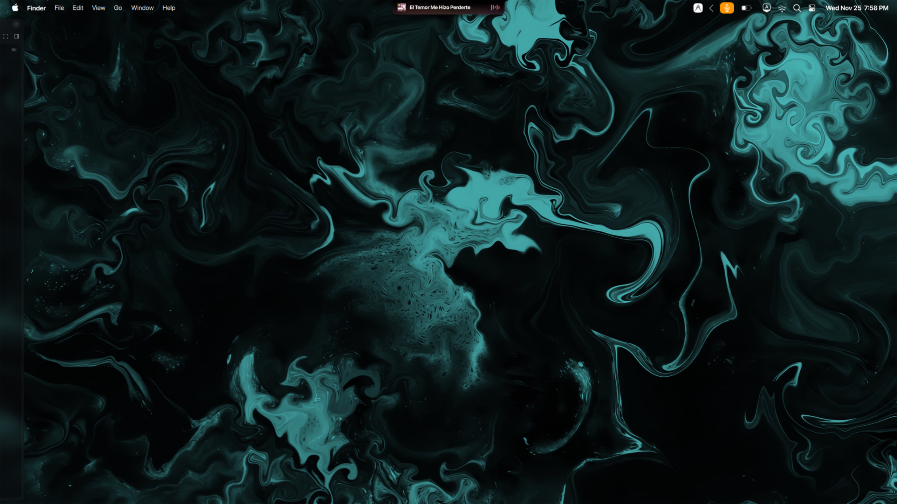
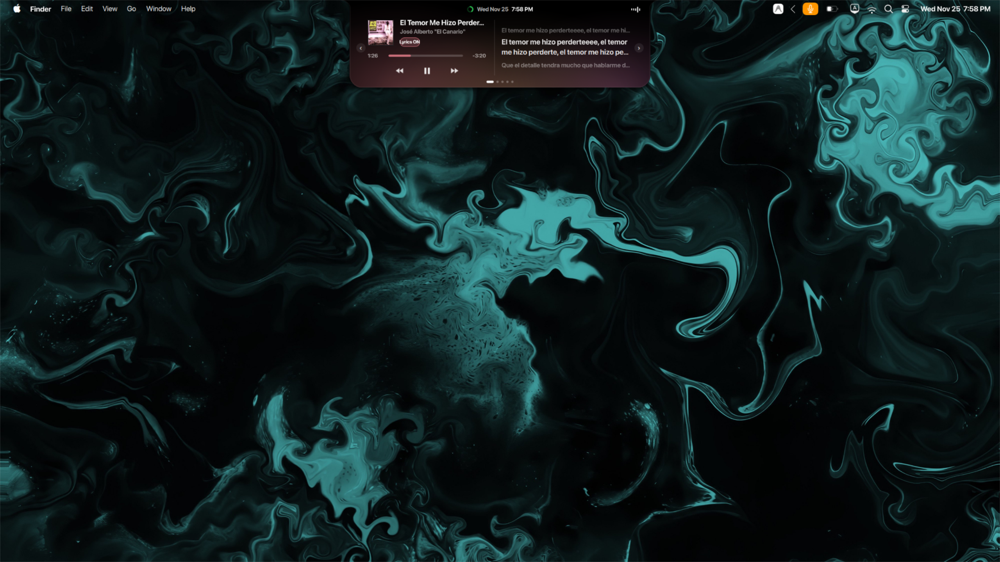
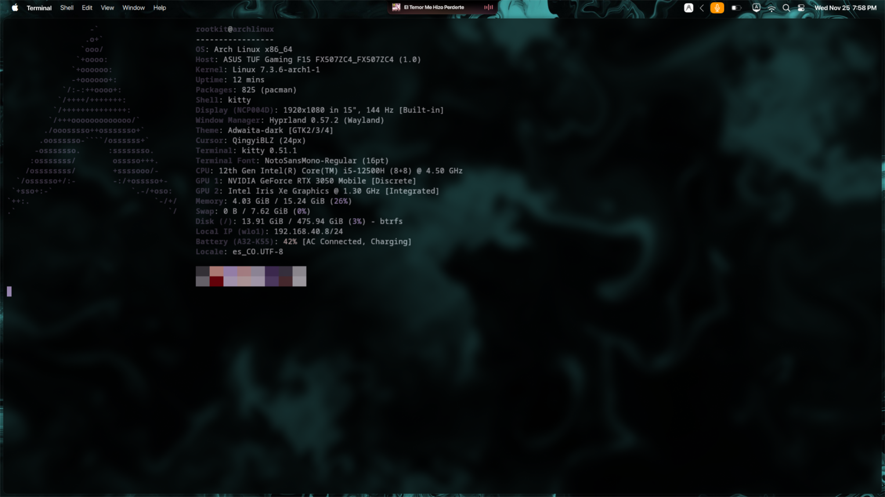
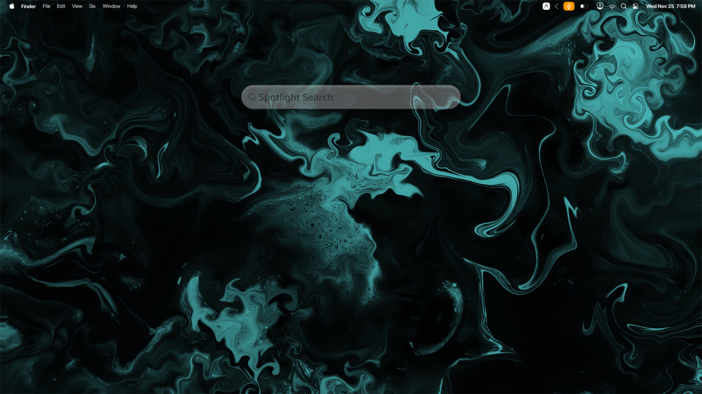

# Arch Linux + Hyprland (Lua) + Quickshell macOS Minimal

> Fork personalizado de [vzbc/revo-shell](https://github.com/vzbc/revo-shell) — optimizado para Arch Linux + Hyprland Lua, con la **Dynamic Island full vibecodeada** y colaboración de **Claude Code** en el shell `macos`.



## Capturas

| Dynamic Island Expandido + Letras Sincronizadas | Terminal Kitty Obsidian Glass + Fastfetch |
|---|---|
|  |  |

| Spotlight |
|---|
|  |

Entorno completo, ligero y optimizado para **Arch Linux** (probado en ASUS TUF Gaming F15 FX507ZC4 híbrido Intel Iris Xe + RTX 3050 Mobile) con:

- **Hyprland (Lua config):** Dock Liquid Glass (`hyprliquid`) con autohide y `exclusiveZone` exacto, blur nativo *frosted glass*, y soporte de iGPU Intel (`AQ_DRM_DEVICES` resuelto al nodo real `/dev/dri/cardN` para compatibilidad con Aquamarine).
- **Quickshell macOS Minimal (`macos` + `eqsh`):**
  - **Dynamic Island (full vibecodeada, estilo Nusa):** reproductor MPRIS con lista desplegable de fuentes (control individual y filtro automático de clips de `x.com`), letras sincronizadas (`LRCLIB` con caché por álbum y duración), autofocus al clic en canción/notificaciones (GUI y CLI), respuesta en línea, animaciones nativas Bluetooth y píldora en vivo de grabación de pantalla con botón directo a `mpv`.
  - **Apple Music Lyrics Lock Screen:** carátulas HD `1200×1200`, letras sincronizadas centradas y reloj **MacGlassClock** (Liquid Glass).
  - **Visual Intelligence (`Super + G`):** recorte en pantalla estilo macOS con búsqueda por imagen (Google Lens) y consulta directa a Antigravity.
  - **Spotlight (`Super`):** lanzador principal con historial de portapapeles (`Super + V`).
  - **Bajo consumo:** sin repaints de 144 FPS en reposo (`quickshell` ~0.5–1.5% CPU, ~257 MiB PSS), carga bajo demanda (`Loader`) y sin daemons zombis (`swayosd`, `rofi`, `matugen`, `Xorg`).
- **Estética Obsidian Glass coherente:**
  - **Kitty:** negro puro `#000000` + frosted blur de Hyprland (`0.72 / 0.62`).
  - **ZapFast & Telegram:** temas personalizados **Obsidian Glass** + frosted blur (`0.78 / 0.68`).
  - **YouTube Music (Pear Desktop):** barra superior oculta, modo ambiente desactivado y bloqueador de anuncios nativo (`do-not-track` en modo `In player`).
- **Sistema listo de fábrica:** **SDDM en Wayland** (`weston --shell=kiosk` + tema **MacSDDM**, cero `Xorg`), **ZRAM (`zstd`)**, perfil Bluetooth A2DP compatible en WirePlumber (`sbc`/`sbc_xq`/`aac`), repos **CachyOS `x86-64-v3`** opcionales, y `makepkg.conf` rápido (`!strip`, `!debug`, `zstd -T0 --fast`).

---

## Instalación rápida

```bash
chmod +x install.sh
./install.sh
```

### Modos disponibles
- `./install.sh` — Instalación completa (repos CachyOS v3 + paquetes oficiales + AUR + dotfiles + SDDM/ZRAM).
- `./install.sh --dotfiles-only` — Solo despliega configuraciones, temas y scripts (hace backup automático en `~/.config-backup-*`).
- `./install.sh --skip-cachyos` — Omite agregar repositorios de CachyOS.
- `./install.sh --skip-aur` — Omite paquetes AUR.
- `./install.sh --dry-run` — Simula los pasos sin modificar el sistema.

---

## Atajos principales

| Atajo | Acción |
|---|---|
| `Super` | Spotlight |
| `Super + T` | Terminal (`kitty`) |
| `Super + E` | Archivos (`nautilus`) |
| `Super + B` | Firefox |
| `Super + C` | Antigravity |
| `Super + L` | Lock Screen (MacGlassClock + Apple Music Lyrics) |
| `Super + G` | macOS Visual Intelligence (captura + Lens / Antigravity) |
| `Super + Shift + S` | Captura de región (`slurp` + `grim` → portapapeles + `~/Imágenes`) |
| `Print` | Captura instantánea de pantalla completa |
| `Ctrl + Print` | Captura de región + editor `swappy` |
| `Super + Shift + R` | Grabar pantalla completa 60 fps (`gpu-screen-recorder`, audio del sistema sin mic) |
| `Super + Alt + R` | Grabar región 60 fps |
| `Super + V` | Portapapeles / galería de capturas |

---

## Créditos y Colaboradores

- **Fork base:** [vzbc/revo-shell](https://github.com/vzbc/revo-shell) — proyecto original de Revo Shell sobre el cual nace este fork personalizado.
- **Colaborador en `macos`:** **Claude Code** — colaboración en la base y ajustes del shell `macos`.
- **Dynamic Island:** full vibecodeada desde cero sobre Quickshell (animaciones, selector desplegable de fuentes MPRIS, letras sincronizadas, notificaciones interactivas y autofocus).
